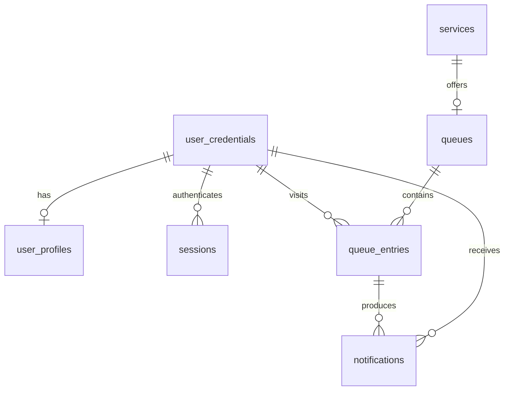

# Database schema

Source: [schema.sql](../server/src/data/schema.sql). PostgreSQL 14+; verified with
PostgreSQL 18. The seven tables cover the assignment's six data categories plus
session storage. See [setup](database.md) and [service APIs](service-api.md).

## Shared conventions

- Entity IDs use `uuid`, generated by `gen_random_uuid()` unless supplied by a seed.
- Event times use `timestamptz`; return UTC ISO strings in APIs and format locally
  in the UI. Names use snake_case in SQL and camelCase in the current APIs.
- Required columns are `NOT NULL`. The nullable fields below are explicitly marked.
- Credentials, profiles, services, and queues have `created_at` and `updated_at`
  timestamps, both defaulting to the current time. Triggers refresh `updated_at`.
- Text statuses use CHECK constraints. Names, messages, and hashes cannot be blank.
- The schema bootstrap creates all objects in one transaction. Future structural
  changes need migrations; rerunning setup does not upgrade an existing schema.

## Relationships

The shared profile primary key and unique queue service ID enforce at most one
profile per account and queue per service. Registration must create credentials
and profile together; service creation already creates its queue atomically.

## Tables and fields

### user_credentials (assignment: UserCredentials)

| Column | Type | Rule |
| --- | --- | --- |
| id | uuid | Primary key; generated UUID |
| email | varchar(100) | Unique, lowercase, trimmed, valid basic email shape |
| password_hash | text | Backend-generated salted password hash; never plaintext |
| role | text | `user` or `admin`; default `user` |
| created_at, updated_at | timestamptz | Creation/update metadata |

The normalization check plus email uniqueness prevents case variants of the same
email. Password strength, account domain rules, hashing, and role authorization
remain backend responsibilities. Preserve the existing salted scrypt approach.

### user_profiles (assignment: UserProfile)

| Column | Type | Rule |
| --- | --- | --- |
| user_id | uuid | Primary key and foreign key to user_credentials.id |
| full_name | varchar(60) | Required, nonblank |
| phone | varchar(30) | Nullable; nonblank when present |
| created_at, updated_at | timestamptz | Creation/update metadata |

Retrieve email by joining credentials on user_id. This implements the assignment's
profile-to-account reference without maintaining a duplicate email column.
Preferences are omitted because the current UI has no preference feature.

### services (assignment: Service)

| Column | Type | Rule |
| --- | --- | --- |
| id | uuid | Primary key |
| name | varchar(100) | Required, nonblank |
| description | varchar(500) | Required, nonblank |
| expected_duration_minutes | double precision | Positive finite minutes; fractions allowed |
| priority | integer | 0 through 2147483647; default 0; higher ranks first |
| created_at, updated_at | timestamptz | Creation/update metadata |

Infinity and NaN are rejected. Service names are not required to be unique.
Normal startup never overwrites saved service values.

### queues (assignment: Queue)

| Column | Type | Rule |
| --- | --- | --- |
| id | uuid | Primary key |
| service_id | uuid | Unique foreign key to services.id |
| status | text | `open` or `closed`; default `open` |
| created_at, updated_at | timestamptz | Creation/update metadata |

Reuse the same queue when reopening a service. Closing should prevent new joins
and retain existing visits. Member 3 must enforce this policy in the SQL-backed
join/close APIs, locking the queue row within the relevant transactions.

### queue_entries (assignment: QueueEntry)

| Column | Type | Rule |
| --- | --- | --- |
| id | uuid | Primary key; one ID per visit |
| queue_id | uuid | Foreign key to queues.id |
| user_id | uuid | Foreign key to user_credentials.id |
| arrival_sequence | bigint identity | Generated unique tie-breaker; gaps are allowed |
| priority | integer | Nonnegative priority snapshot from service |
| status | text | `queued`, `serving`, `served`, or `left`; default `queued` |
| joined_at | timestamptz | Defaults to current time |
| service_started_at | timestamptz | Nullable until service starts |
| completed_at | timestamptz | Nullable until service completes |
| ended_at | timestamptz | Nullable until completed or left |
| service_name_snapshot | varchar(100) | Required service name captured for this visit |

Derive service_id through queues.service_id; the existing API can still return
serviceId. Capture service priority/name on join rather than rewriting old visits
when an administrator edits a service. Use the authenticated user ID.

| Status | Meaning | Required timestamp state |
| --- | --- | --- |
| queued | Waiting | No start, completion, or end time |
| serving | Receiving service | Start present; completion/end absent |
| served | Completed | Start present; completion equals end |
| left | Canceled before service | End present; start/completion absent |

Timestamp checks reject starts/ends before joining and completion before service
start. A partial unique index permits only one queued/serving visit per user
across all services. Backend transactions must enforce allowed state transitions
and prevent concurrent administrators from claiming the same visit.

### notifications (assignment: Notification / History)

| Column | Type | Rule |
| --- | --- | --- |
| id | uuid | Primary key |
| user_id | uuid | Foreign key to user_credentials.id |
| queue_entry_id | uuid | Required visit reference |
| type | text | `joined` or `near_turn` |
| message | text | Required, nonblank |
| status | text | `sent` or `viewed`; default `sent` |
| created_at | timestamptz | Defaults to current time |
| viewed_at | timestamptz | Null for sent; required for viewed |
| dismissed_at | timestamptz | Nullable; hides an alert without deleting it |

A composite foreign key (queue_entry_id, user_id) ensures an alert belongs to
the visit's owner. UNIQUE(user_id, queue_entry_id, type) prevents repeated events,
including after dismissal. Viewed/dismissed times cannot precede creation.
Here, sent means available in the application, not email or SMS delivery.

### sessions (additional support for existing authentication)

| Column | Type | Rule |
| --- | --- | --- |
| token_hash | text | Primary key; lowercase 64-character SHA-256 hex digest |
| user_id | uuid | Foreign key to user_credentials.id |
| created_at | timestamptz | Defaults to current time |
| expires_at | timestamptz | Required; later than creation |

Bearer tokens are hashed with SHA-256 before storage and lookup; expired rows are
rejected and removed, and logout deletes the row. Tokens and passwords use
different hashing mechanisms.

## Views, indexes, and deletion

- `queue_positions`: only queued entries, numbered per queue by priority DESC,
  joined_at ASC, arrival_sequence ASC. This implements the assignment's position
  field without maintaining a mutable position column.
- `user_queue_history`: served/left visits with service-name snapshot and actual
  waiting minutes (join to service start). Left visits have null wait_minutes.
  APIs must filter this view by the server-verified user ID.
- History and reports derive from retained visits rather than duplicate tables.
- Indexes support active-visit uniqueness, queue ordering, visit lookup/history,
  notification lookup/deduplication, and session ownership/expiry.
- Credentials deletion cascades to profile and sessions. Visits and notifications
  restrict deleting referenced accounts; queues/visits restrict deleting referenced
  services/queues. These rules preserve history. Close queues instead of deleting
  active data. Account deletion policy changes require team coordination.

The schema provides storage/constraints for all members. Only services and their
initial queue creation currently use it through production APIs; see the current
migration boundary in [database setup](database.md).
